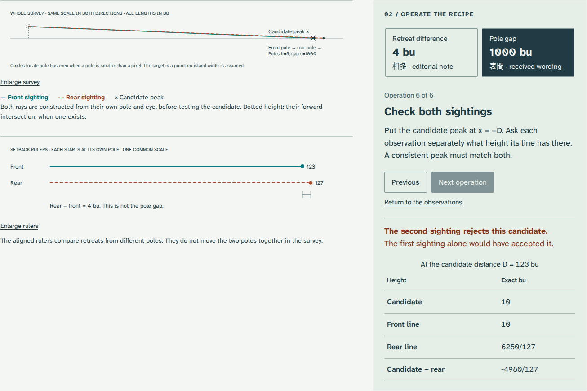

# Haidao

**Test a sea-island calculation against two sightings.**

[Live lesson](https://antonsoo.github.io/haidao/) · [MIT](LICENSE)

The first problem of Liu Hui's *Sea Island Mathematical Manual* gives two equal
poles and two ground-level sighting retreats. In the retained printed witness,
the commentary names the pole gap as a divisor; a small editorial note corrects
it to the difference between the retreats. The wrong divisor still satisfies
the first observation. The second observation exposes it.



Haidao makes that discrepancy operable. Follow the numerical recipe, try both
divisors, check the two independently constructed sight lines, then read the
Classical Chinese beside whole photographed source openings. A separate modern
experiment shows how uncertainty in a small setback difference can leave the
island height and distance without any finite upper bound.

## Run locally

Node 24 or newer:

```sh
git clone https://github.com/antonsoo/haidao.git
cd haidao && npm ci
npm run dev
```

Open `http://127.0.0.1:4333/haidao/`. `npm run build` creates the static site in
`dist/`; `npm run preview` serves that build on the same port. The browser app has
no framework runtime, account, analytics or third-party network requirement.

## Try the two divisors

1. Keep **Source exercise**. Advance through the six operations. The difference
   `127 − 123 = 4 bu` gives `H = 1255 bu`, `D = 30750 bu`, and both sightings agree.
2. Select **Pole gap**. This produces `H = 10 bu`, `D = 123 bu`. The front sighting
   still agrees. The rear sight line is `6250/127 bu` high at that distance:
   the candidate misses it by `−4980/127 bu`.
3. Read passages 6 and 7. Opening 11 preserves both the received wording and the
   smaller editorial correction. Enlarge and pan the source with a keyboard.
4. Give each retreat an independent **±1 bu** allowance. Height can range from
   `2515/3` to `2505 bu`. At **±2 bu**, the allowed positive retreat difference
   approaches zero and there is **no finite upper bound**.

The **Nearby comparison** uses new illustrative numbers to make the geometry
less shallow. **Equal retreats** keeps the parallel case visible. Custom records
may use positive quarter-bu increments; invalid edits never partially alter an
applied record. Both divisor choices can agree when their numerical values
happen to coincide.

## Read and retain the evidence

- Ten selected Chinese clauses, new English renderings, thirty word notes and
  modern Mandarin pronunciation aids distinguish the procedure, received
  commentary and Qing editorial voice.
- Five complete photographed openings from Waseda University Library ni02 00649,
  catalogued as 1777, include the bibliographic preface dated 1775. These are
  later witnesses, not a third-century manuscript. No modern translation or
  historical illustration is reproduced.
- **HTML** embeds the complete readings, source openings, two fonts, exact
  record, worksheet, source identities and complete licenses. It works with
  scripts disabled and the network unavailable, and prints to A4.
- **CSV** preserves exact fractions for both proposed divisors, the operator's
  reached stage, each sight-line residual and the interval's actual status.
- **SVG** preserves the equal-scale whole survey, embeds its font and includes
  the record and licenses. Enlarging a diagram changes its display size equally
  in both directions.
- A shared address restores the applied observations, divisor, operation,
  passage, source opening and uncertainty allowance. Unapplied form edits remain
  visibly separate from the record used for drawings and downloads.

Retained native examples and the printable reading copy are in [examples](examples/).
The [model and source notes](docs/model.md) explain the evidence boundaries;
the [review](docs/review.md) records actual browser and artifact checks.

## How the model works

Set the front pole at `(0,h)` and the rear pole at `(s,h)`. The ground eyes are
`(a,0)` and `(s+b,0)`. A common island peak is `(-D,H)`.

```text
Observation     Line                         Independent height at x=-D
Front           h*x + a*y = h*a               h*(a+D)/a
Rear            h*x + b*y = h*(s+b)           h*(s+b+D)/b

Their intersection: D*(b-a) = a*s; H = h + h*s/(b-a)
```

All decisions and output fractions use reduced `BigInt` rational arithmetic.
Only drawing converts to floating point. The rays are constructed from their
own pole and ground eye, rather than drawn through a presumed correct answer.

For independent allowed setbacks `a±e`, `b±e`, positive difference bounds are
`(b-a)±2e`. Height and distance decrease as the difference increases. When the
whole allowed difference interval is positive, exact corner values attain the
two extrema. When the interval reaches zero and includes positive values,
forward cases have no finite upper bound. Nonpositive allowed setbacks are
reported as outside this interval model; they are never silently clipped.

The offline worker hashes the **finished build files**, verifies every response
before installation, and reports readiness only when the page and controller
editions agree and every cached file passes its identity check. Cache inspection
does not create a missing cache. The user can explicitly rebuild an incomplete
copy. Source viewing and HTML downloads separately verify the retained asset
identities and reject substituted or incomplete files.

## Accuracy and limits

This is an idealized geometry lesson, not a survey tool. The model assumes a
level common baseline, equal vertical poles, point-like tips and targets, and
eyes at ground level. It does not model terrain, refraction or instrument error.
The modern uncertainty experiment holds pole height and pole gap exact and
places no probability distribution on allowed setbacks.

The selected Chinese clauses have supplied modern punctuation. Pinyin is a
modern Mandarin aid, not reconstructed ancient pronunciation. The whole source
openings retain the notes and layout; this is not a complete critical edition.
The contradictory wording is attributed to the received printed commentary,
without guessing when it entered the transmission. No physical expedition,
island location or absolute conversion to metres is inferred.

## Validation

```sh
npm run check
npm run verify:survey
```

The second command compares 3,005 records with an independent Python `Fraction`
line-intersection calculation, including 6,009 candidates and 121,132 forward
interval samples. It does not import the TypeScript solver. Python 3's standard
library is sufficient. Browser verification operates the actual controls and
downloads in Chromium and Firefox at desktop and 375 pixels:

```sh
npm run build
npm run preview
node scripts/browser-check.mjs http://127.0.0.1:4333/haidao/ /tmp/haidao-browser
node scripts/source-guards.mjs /tmp/haidao-source-guards.json
```

Install Playwright's Chromium and Firefox if they are not already available.
Source photograph and font reproduction instructions are in [docs/model.md](docs/model.md).

## Contributing

See [CONTRIBUTING.md](CONTRIBUTING.md). Historical claims need traceable sources;
mathematical changes need an independent comparison or a reproduced learner
failure. Prefer a deeper, checkable lesson to a larger catalogue.

## License and sources

Original software, diagrams, selected transcription and English: [MIT](LICENSE),
Copyright © 2026 Anthony Mercer. The photographed historical book is public
domain; fonts carry their complete SIL Open Font License notices.

- [Waseda scan and catalogue metadata](https://commons.wikimedia.org/w/index.php?curid=99007136).
- [Waseda catalogue](https://www.wul.waseda.ac.jp/kotenseki/html/ni02/ni02_00649/index.html).
- Ang Tian Se and Frank J. Swetz, [“A Chinese mathematical classic of the third
  century: The sea island mathematical manual of Liu Hui”](https://doi.org/10.1016/0315-0860(86)90024-8),
  *Historia Mathematica* 13 (1986), 99–117. Historical context only; its translation
  and figures are not bundled.
