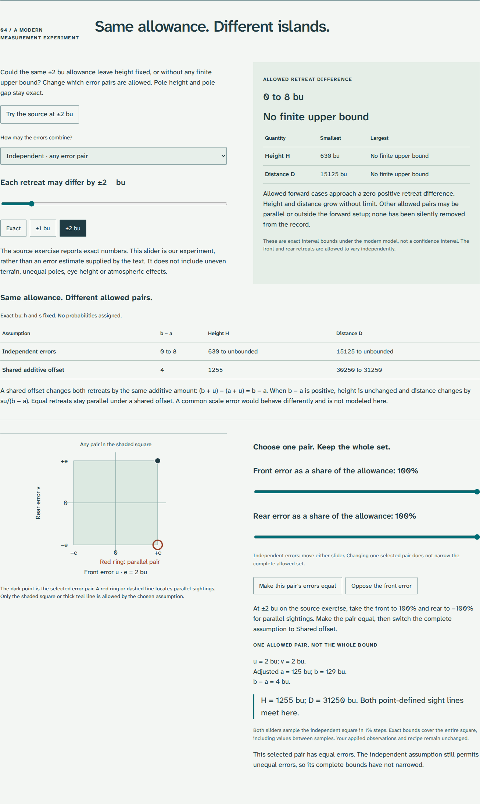

# One selected island is not the complete allowed set

Audit begun 2026-11-03 and continued 2026-11-04. The initial shared-offset
addition was reviewed again from its actual source and browser behavior,
including a separately built `fc55571` baseline. This record distinguishes
mathematics, learner operation, transfer failures and publication evidence.

## Try the actual work

Open **Uncertainty**, then **Try the source at ±2 bu**.

1. The selected front/rear errors are +99% and −99%. Their retreat difference
   is 1/25 bu. The height is 125005 and distance 3124500 bu.
2. Move the front to +100% and rear to −100%. The two sightings become
   parallel; no finite peak replaces the division by zero.
3. Choose **Make this pair's errors equal**. Height is now 1255 bu. The full
   independent height bound remains unbounded: selecting an equal pair has
   not excluded unequal pairs.
4. Switch the complete assumption to **Shared offset**. Only equal errors are
   now allowed; the full height bound becomes fixed at 1255 bu, and the full
   distance range is 30250–31250 bu.
5. Return to independent errors and move either control separately. The rear
   setting is restored. Save CSV, a complete reading or the address; the
   original applied observations and recipe remain unchanged.

| At ±2 bu on the source exercise | Difference, bu | Height, bu | Distance, bu |
| --- | --- | --- | --- |
| Complete independent square | 0 to 8 | 630; unbounded above | 15125; unbounded above |
| Complete shared-offset diagonal | 4 | 1255 | 30250 to 31250 |
| One selected equal pair, +2 / +2 | 4 | 1255 | 31250 |

The original addition's single slider could visit only the opposing diagonal
inside the independent square. The revised controls sample the square in two
dimensions. Their 1% grid is explicitly distinguished from the continuous set
used for exact bounds. At front +37%, rear −60%, a real keyboard-operated case
has `H=250515/103`, `D=6187000/103` bu and diagram point `(252,215)`.
Older addresses without a rear probe preserve the original opposing pair.

These are modern assumptions about an idealized source exercise. No ancient
error distribution, instrument precision, common-scale calibration, physical
expedition or measurement of an island is inferred. “Independent” describes a
Cartesian allowed set, without a probability distribution. The derivation and
nonpositive-domain boundary are in [the model](model.md#equal-errors-change-the-allowed-set).



[Phone view](assets/error-pair-mobile.png). The exact comparison table has a
labelled horizontal scroll on small screens; native controls remain in the page.

## Defects reproduced, then repaired

The [baseline receipt](evidence/audit/before.json) was produced from the earlier
committed source, not a synthetic reconstruction of a supposed failure.

| Reproduced behavior | Revised behavior |
| --- | --- |
| In default-motion Chromium, a fresh #uncertainty URL stayed at the page top; the reduced-motion journeys had missed it | Remove smooth scrolling so native fragment navigation can land at the experiment; check all four sections at both widths and motion settings |
| A source arriving steadily in chunks failed at roughly 15 seconds in both engines | The timeout measures inactivity. Valid long transfers continue; stalled headers/bodies fail after 15 seconds without data |
| One tab detected a deleted cache while another still claimed ready | Detection withdraws readiness in other tabs; returning to a tab rechecks its bytes |
| After a failed first install, clicking the check button made no new request and could not install a worker | A direct retry starts installation again and keeps the experiment |
| Rebuild had a fixed 45-second response window | Progress keeps the channel alive; a healthy roughly 51-second repair passed in both engines |
| Repair deleted a usable cache before replacing all files | Verified entries are retained and only missing/damaged files are fetched; a stalled repair retained all 17 unaffected files |
| Cached fetches returned unchecked bytes | Every known cached response is verified, and a network replacement must pass the same byte-length/hash checks |
| A saved reading could not be cancelled | Cancel aborts its peer requests and refuses late download/progress; controls retain subsequent edits |

A race introduced during this repair was also caught: a late cross-tab
incomplete notice overwrote the specific stall explanation. Failure broadcasts
now retain that reason. The audit checked the resulting message and retry,
not merely the existence of an incomplete cache. A blocked service-worker
registration also gets a plain recovery message rather than an internal error.
Invalid-address warnings clear once the operator makes a valid selection and
return when browser history restores the invalid address.

Source/view/export reads and background installation use one streamed verifier.
It bounds allocation by the expected byte length, rejects overlong and truncated
bodies, checks SHA-256 before use, and removes already-decoded HTTP compression
headers when creating a verified response. Two background transfer lanes avoid
starting every source simultaneously. Repair broadcasts do not claim completion;
a full inventory of the page's matching controller edition is still required.

## Operated evidence

A fresh archive of source `34ffa66302cd6e13c422048db9e93e36d1b33830`
passed `npm ci`, the strict build and nine model/URL cases on Node 24.22.1.
All 19 clean-build files match the working-tree build and local served bytes;
[the clean-build receipt](evidence/audit/clean-build.json) records every hash. The independent
Python oracle imports no app code. It calculates intersections from the two
point-defined lines and checks 3005 records, 6009 candidates, 60100 selected
pairs, 121132 independent-set samples and 31395 common-offset samples.
See [the exact receipt](evidence/audit/oracle.json).

| Evidence | What was actually checked |
| --- | --- |
| [Native section journeys](evidence/audit/fragments.json) | All four initial fragments in both engines, both widths and both motion modes; section visibility, native history policy and both probe values retained |
| [Initial fragment regression](evidence/audit/fragments-before.json) | Direct observation of the default-motion Chromium failure, with reduced-motion and script-disabled comparisons; native link clicks still worked |
| [Baseline](evidence/audit/before.json) | Both-engine reproduction of healthy-transfer refusal, stale other-tab readiness and ineffective first-install retry |
| [Transfer failures](evidence/audit/transfers.json) | Chromium/Firefox at 375 px, slow source and saved reading beyond the old deadline, cancellation, snapshot isolation, direct retry, stalled headers/bodies, wrong/truncated/overlong source bytes |
| [Cold shared connection](evidence/audit/cold-transfers.json) | First installation and foreground reads share one 128000-byte/s origin; both source reads exceed the former deadline, complete edition installs, then real connections are refused without browser offline emulation |
| [Storage-write failure](evidence/audit/storage.json) | A deliberately injected Cache.put QuotaExceededError in both engines erased all 17 remaining entries in the earlier implementation; the revised implementation retained all 17 unchanged. This is controlled fault injection, not a claim to measure device capacity |
| [Edition upgrade](evidence/audit/upgrade.json) | Failed new installs retain the old edition; successful upgrades withdraw old-page readiness. The current client also reloads through another actual build while preserving both selected percentages and operating through a real connection outage |
| [Offline repair](evidence/audit/offline.json) | Failed first-install retry, cross-tab invalidation, healthy repair beyond 45 seconds, preservation after body stall, corrupt cached source plus wrong network replacement, edition-mismatch refusal, native readings during actual connection outage |
| [Source failure guards](evidence/audit/source-guards.json) | Substituted photograph/export refused; a late response does not replace a newly chosen page; held source prevents readiness; cache inspection creates no empty cache, then repair and reload work |
| [Native pair records](evidence/audit/pair-artifacts.json) | Independent Python intersections, both exact bounds, actual SVG marker coordinates, native CSV/HTML source bytes and license notices |
| [Language and print](evidence/audit/language-artifacts.json) | All 120 language fields in each reading; embedded font/license identities; all five PDF source JPEGs byte-identical; 27 PDF pages with text within page bounds |

The [complete ordinary lesson journey](evidence/audit/browser.json) is also operated in Chromium and Firefox
at 1440 and 375 px: both divisors, readings, keyboard source panning, history,
unapplied drafts, arbitrary and equal error pairs, native files, standalone
readings without scripts/network, and offline reload. Page errors and the
bounded automated accessibility audit are checked in those actual states.
[Publication and final delivery receipts](audit-publication.md) are recorded separately. Reducing only the
printed error diagram's width prevents the source/model note from spilling onto
an otherwise almost empty page; the current shared reading is 27 pages, with
the same complete source and license material.

The source readings remain the same selected clauses and photographs. The
earlier audit inspected whole openings 10–11 directly. Live original catalogue
and PDF retrieval returned errors in that environment; neither this mathematics
extension nor retained-hash comparisons establish a fresh scholarly edition or
new primary-source acquisition.

## Reproduce the audit

Build once before running these scripts; do not rebuild that directory while a
browser journey is using it. The longer fault scripts create isolated actual
origins and do not require a separately running preview.

```sh
npm ci
npm run check
npm run verify:survey
npm run preview
node scripts/browser-check.mjs http://127.0.0.1:4333/haidao/ /tmp/haidao-browser
node --import tsx --input-type=module -e 'import { readings } from "./src/content.ts"; process.stdout.write(JSON.stringify(readings))' > /tmp/haidao-readings.json
python3 scripts/artifacts.py /tmp/haidao-browser --readings /tmp/haidao-readings.json
python3 scripts/error-artifacts.py /tmp/haidao-browser
node scripts/transfer-audit.mjs /tmp/haidao-transfers
node scripts/offline-audit.mjs /tmp/haidao-offline
node scripts/cold-transfer-audit.mjs /tmp/haidao-cold
node scripts/source-guards.mjs /tmp/haidao-source-guards.json
```

After publication, `scripts/verify-hosted.mjs` compares all canonical HTTPS
files with `dist/`. `scripts/public-outage.mjs` installs the actual public TLS
edition through a tunnel, destroys its real connections and refuses new ones,
then verifies source reading, native files and reload with browser networking
still enabled. Neither script infers publication from a local success.

The baseline source is `fc55571`: build it separately, then pass its `dist/` to
`scripts/audit-before.mjs` and `scripts/upgrade-audit.mjs`. The latter also accepts
an optional fourth argument for another separately built edition. Appending a
CSS comment before building an isolated source copy changes its source edition
without changing the intended lesson; this exercises the current client's own
reload action and preservation of both probe values. No alternate test edition
is intended for publication.

Playwright's existing Chromium/Firefox are used. Python's standard library and
Poppler (`pdfinfo`, `pdftotext`, `pdfimages`) handle the independent artifact
review. The production command is `npm run build`, output `dist/`.

These checks do not establish physical surveying, physical printing, every
assistive-technology path, arbitrary browser storage policies or an unlimited
background service-worker lifetime. Browser scheduling can suspend an install;
the app offers retry and makes no offline claim before verification completes.
