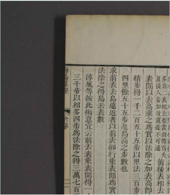
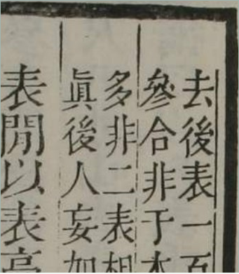

# Read the small note at full resolution

The first phone version enlarged the complete 3,600-pixel photograph to only
777.59375 CSS pixels in a 324-pixel scrollable frame. The main columns could be
followed, but the small editorial correction remained difficult to read.

The source button now reads **Read at full resolution**. It displays each
photograph at its full natural width of **3,600 CSS pixels**, with horizontal and
vertical keyboard panning. The initial viewport starts over the upper printed
text of the left leaf, rather than the outer background. The complete photograph
is retained, with no crop, retouch or replacement. **Fit whole opening** returns
to the complete overview. Changing openings while enlarged retains this usable
starting position. The phone dropdown has its own row.

The before image is an actual capture of the public first edition. The after
image is an actual capture of the revised built edition, showing the small
editorial text in opening 11. Both Chromium and Firefox at desktop and 375 pixels
confirmed that displayed width equals natural width, and that a keyboard right
arrow advances the existing horizontal scroll position. See
[source-resolution-browser.json](evidence/source-resolution-browser.json).

The full operated lesson was repeated in all four configurations. All forty
native HTML/CSV/SVG downloads remain byte-identical to those from the previously
reviewed source, since the observation model and portable reader did not change.
The source-resolution parity receipt records that comparison. This is a source
viewer improvement; no new historical interpretation or source photograph was
introduced.
